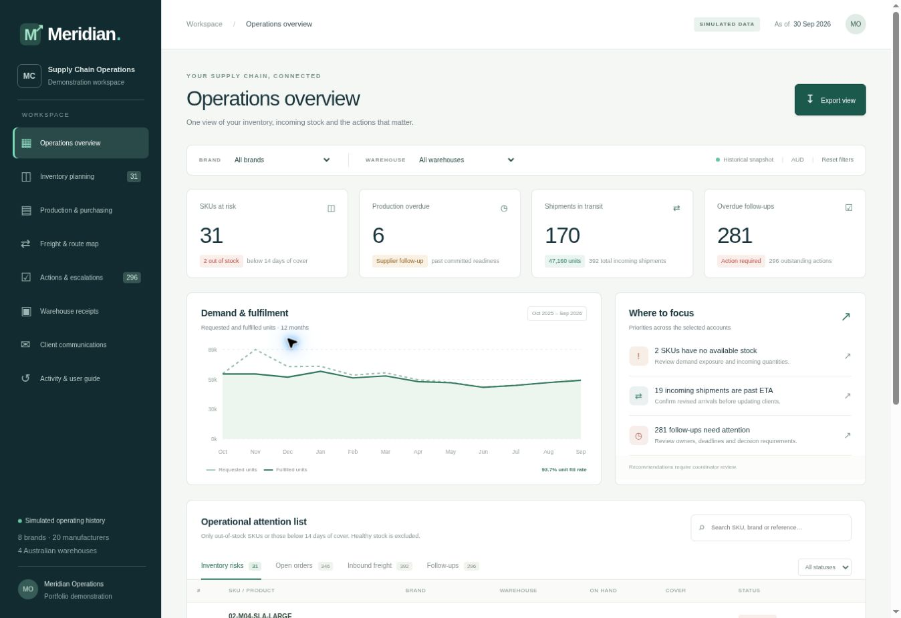

# Meridian - Showcase

E-commerce Supply Chain & Client Operations. A portfolio demonstration using simulated data.

**Release 1.0 — six operational modules, saved demo workflows and an illustrative air/sea freight map.**

[Business Case](Business-Case.md) · [User Guide](docs/User-Guide.md) · [Architecture](docs/Architecture.md)

## Demonstration scope

| Module | Implemented workflow |
|---|---|
| Production & Purchasing | Draft and approve POs, validate MOQ/cartons, revise readiness and record completion |
| Inventory Planning | All 250 SKUs, stock cover, recent requested demand, stock value and replenishment suggestions |
| Freight Coordination | Air/sea route map, packing details, bookings, departure/ETA updates and consolidation proposals |
| Warehouse Receipts | Expected/accepted/damaged/missing reconciliation, validated sample CSV batches and discrepancy follow-ups |
| Client Communications | Account briefing, editable draft versions, approvals and text exports; nothing sent |
| Actions & Escalations | Assigned deadlines, resolution notes, reopening, reassignment and activity history |

Brand and warehouse filters, numbered tables, search, status filters, pagination and exports are included. Signed-in demo changes persist in a server-side personal workspace. Historical baseline data remains reproducible and unchanged.

The scenario date is 30 September 2026. Actual event dates respect that cutoff; plans may extend beyond it. The map uses approximate geography and illustrative routes; packaging weights and volumes are demonstration assumptions, not carrier measurements. The inventory policy uses recent average demand, nominal lead times, MOQ and cartons; it is not an optimised forecast.

No external supplier orders, carrier bookings, email, WeChat messages, Shopify or Canary7 transactions are submitted. Sample receipt files are not certified vendor imports. This is a completed portfolio demonstration of the agreed workflows, not a production ERP or evidence of achieved client savings.

## Data and validation

8 fictional brands, 250 SKUs, 20 manufacturers and 4 Australian warehouses over twelve months. The baseline includes 2,473 purchase orders, 2,890 shipments, 2,498 receipts and 2,072 operational exceptions. Values are simulated; monetary figures use AUD.

26 automated tests pass, alongside TypeScript validation, a production build and browser workflow checks. The live demonstration remains private pending a separate public-access decision. The implementation stays in the private core repository.

## SKU definition

An **SKU (Stock Keeping Unit)** identifies a specific product variant within a business. Different colours or sizes receive different SKUs. A barcode is the scannable symbol used to encode an identifier.

## Screenshots

Current application screenshots use simulated operating data. They document a functioning web application, not image mockups.

[SS2 - Inventory Planning](assets/screenshots/SS2_Meridian_Inventory_Planning.jpg) · [SS3 - Freight Route Map](assets/screenshots/SS3_Meridian_Freight_Route_Map.jpg)
